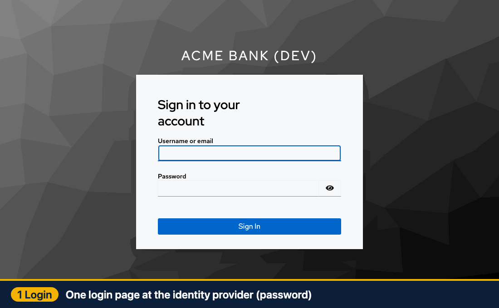
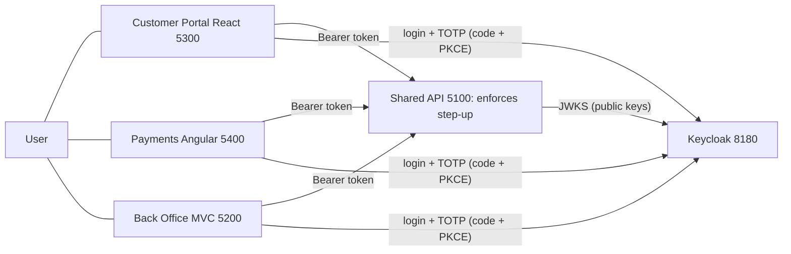

# multi-app-sso-stepup

Proof of concept: single sign-on across three apps (React, Angular, ASP.NET Core MVC) and one shared API using an external IdP, plus step-up MFA re-authentication for sensitive actions.

> Status: early work in progress. PoC, not production-hardened.

Configuration: copy `.env.example` to `.env` (git-ignored) and edit. The example holds placeholders only.

## How it works (animation)



Recorded from a real run of the three apps against Keycloak (the timer part is sped up):
1. **Login:** one password login at the identity provider gives level LoA1.
2. **Step-up:** a risky action (changing the e-mail) is blocked until the user proves a second factor (authenticator code), which gives LoA2 and starts a 1-minute timer.
3. **SSO:** the Payments and Back Office apps open with no login prompt, and a large transfer inside the window needs no second code.
4. **Timer:** the session panel counts the step-up window down.
5. **Expired:** at zero the same transfer is blocked again.
6. **Step-up again:** because the old login is past the window, Keycloak asks for the password again and then a fresh code; a new 1-minute timer starts.

To re-record it with the stack running: `npm --prefix tools/e2e install && npm --prefix tools/e2e run setup && npm --prefix tools/e2e run gif` (about 2 minutes; wait 30 s between runs because a used authenticator code is rejected).

## Repo map (monorepo)

| Folder | Purpose | Port | Status |
|--------|---------|------|--------|
| `apps/react` | Customer Portal (React SPA) | 5300 | built |
| `apps/angular` | Payments and Transfers (Angular SPA) | 5400 | built |
| `apps/mvc` | Back Office (ASP.NET Core MVC) | 5200 | built |
| `api/` | Shared ASP.NET Core API, enforces step-up | 5100 | built |
| `packages/` | Shared code: `idp-profile` (TS loader), `dotnet/IdpProfile` (C# loader and evaluator), `ui-tokens` (Acme Bank look) | - | built |
| `idp/` | Keycloak realm and IdP profiles | 8180 | built |
| `tools/` | `login-probe` (headless login), `e2e` (manual end-to-end run); `idp-check` planned | - | partly built |
| `demo/` | Live-demo script (`run-demo.md`) and 14 backup screenshots | - | built |
| `docs/` | ALL documentation (index: `docs/README.md`, history: `docs/progress-log.md`) | - | yes |
| `agent/` | Task-runner agent files | - | yes |

## How to run it (macOS and Windows)

### 1. Prerequisites
- Docker Desktop (running)
- .NET SDK 10
- Node.js 20 or newer (includes `npm`)
- Free ports: 8180 (Keycloak), 5100 (API), 5200 (Back Office), 5300 (Customer Portal), 5400 (Payments)
- An authenticator app on your phone (Google Authenticator, Microsoft Authenticator and so on). Phone and laptop clocks must be on automatic time, or codes are rejected.

Windows notes: [docs/windows-setup.md](docs/windows-setup.md) (written, not yet run on Windows).

### 2. One-time setup
```text
cp .env.example .env     # Windows PowerShell: Copy-Item .env.example .env
npm run install:all      # installs the React and Angular dependencies
```
The values in `.env.example` are fake, dev-only placeholders and work as they are.

### 3. Start everything
Use the repo root. Each `dev:` command keeps running, so give each its own terminal.

| Terminal | Command | What starts | Address |
|---|---|---|---|
| 1 | `npm run up` | Keycloak (login server) in Docker. Wait about 30 s. | http://localhost:8180 |
| 2 | `npm run dev:api` | Shared API | http://localhost:5100 |
| 3 | `npm run dev:react` | Customer Portal | http://localhost:5300 |
| 4 | `npm run dev:angular` | Payments and Transfers | http://localhost:5400 |
| 5 | `npm run dev:mvc` | Back Office | http://localhost:5200 |

Quick health check: http://localhost:5100/health should answer, and http://localhost:8180/realms/stepup/.well-known/openid-configuration should return JSON.

### 4. Try it
1. Open http://localhost:5300 in a **private/incognito window**.
2. Sign in as `alice` / `alice-dev-only` (password only, level LoA1).
3. Add the authenticator secret once: Base32 `GEZDGNBVGY3TQOJQGEZDGNBVGY3TQOJQ` (6 digits, 30 s, SHA-1). It is a public fake demo seed, see [docs/idp-keycloak.md](docs/idp-keycloak.md).
4. Do a sensitive action (for example change the e-mail on the Profile page). A "step-up required" pop-up appears; enter the current 6-digit code.
5. Use the top navigation to open the other two apps. They open without a login prompt (SSO).
6. Watch the session panel: the countdown shows the 1-minute step-up window. When it runs out, the next sensitive action asks for a code again.

Two surprises: the window is really up to 65 s (5 s clock leeway), and Keycloak rejects a code it already accepted, so wait for the next code (up to 30 s) before a second step-up.

### 5. Stop, reset, troubleshoot
| Need | Do |
|---|---|
| Stop the apps | Ctrl+C in each terminal |
| Stop Keycloak | `npm run down` |
| Clean Keycloak (wipe its state) | `npm run reset`, then wait about 30 s |
| Reset the fake bank data | Restart `npm run dev:api` |
| "Port already in use" | Stop whatever uses it, or change the port in `.env` |
| Valid-looking code rejected | Fix the clocks (automatic time), or wait for the next code |
| Stuck old session | Use a fresh private window, or `npm run reset` |

### 6. Extra checks
- `npm run idp-check`: compares an identity provider's discovery document with a profile.
- `npm run check:evaluator`: runs the step-up evaluator against synthetic claims.
- `npm run probe`: headless login against live Keycloak.
- Headless end-to-end run: `cd tools/e2e && npm install && npm run setup && npm run run` (needs the stack above running).
- Full live-demo script with backup screenshots: [demo/run-demo.md](demo/run-demo.md). Manual verification steps and evidence: [docs/manual-checks.md](docs/manual-checks.md).

## Architecture in one picture



SSO: one Keycloak session cookie links the apps, so the second app signs in without a prompt. Step-up: the API checks `acr` (level) and `auth_time` (age) in the signed access token. If too weak or too old (over 60 s, effectively up to 65 s with the clock-skew leeway) it answers `401` + `WWW-Authenticate: Bearer error="insufficient_user_authentication", acr_values="2", max_age="60"`; the app sends the user back to Keycloak for the authenticator code and retries. Full sequence diagrams: [docs/architecture.md](docs/architecture.md) and [docs/step-up-actions.md](docs/step-up-actions.md).

**Claims relied on:** `acr` (LoA1 = `1`, LoA2 = `2`), `auth_time`, `aud`, `iss`, `exp`. Not `amr` (Keycloak does not emit it).

## Known limitations
PoC, not production-hardened: plain HTTP on localhost, Keycloak dev mode, tokens in SPA memory (a BFF is the production pattern), no back/front-channel logout, in-memory API data and MVC sessions, a public fake TOTP seed, a window that is really up to 65 s, no cumulative transfer limits. Only Keycloak was tested; other IdP profiles are templates. Windows was not run. See [docs/review-checklist.md](docs/review-checklist.md).

## Tested IdPs

| IdP | Status |
|-----|--------|
| Keycloak 26.0 (Docker, local) | **Tested**: login, SSO, step-up, expiry, logout (see `docs/manual-checks.md`) |
| Microsoft Entra ID | Template only, **untested** (`idp/profiles/entra.json`); API refuses a max-age policy with it |
| Okta | Template only, **untested** |
| Amazon Cognito | Template only, **untested** |
| Any other OIDC IdP | `generic.json`: same values as Keycloak, **untested** elsewhere |

No cloud tenant was available, so nothing but Keycloak has ever been run.

## Documentation

Start at [`docs/README.md`](docs/README.md): architecture and IdP communication, token refresh, and the step-up actions.

## Development with the task-runner agent

This repo includes a resumable Claude Code agent that executes a to-do list and
survives terminal shutdowns. See [`agent/README.md`](agent/README.md).

Requirements: [Claude Code](https://claude.com/claude-code), bash.

```text
.claude/agents/todo-runner.md     agent instructions
.claude/commands/run-todos.md     /run-todos command
agent/TODO.md                     your task list
agent/LOG.md                      run history (local, git-ignored)
agent/log.sh                      log helper
```

## Contributing

Work happens in PRs into `main` using `<type>/<slug>` branches; see [CONTRIBUTING.md](CONTRIBUTING.md). Open an issue before large changes. Do not commit secrets, client secrets or
tokens, and keep real IdP credentials out of the repo. See [SECURITY.md](SECURITY.md).

## License

[MIT](LICENSE).
