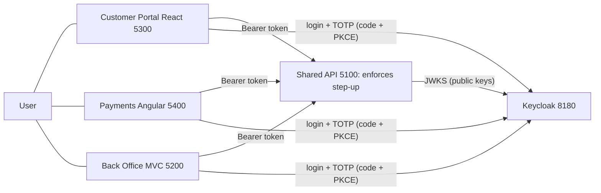

# multi-app-sso-stepup

Proof of concept: single sign-on across three apps (React, Angular, ASP.NET Core MVC) and one shared API using an external IdP, plus step-up MFA re-authentication for sensitive actions.

> Status: early work in progress. PoC, not production-hardened.

Configuration: copy `.env.example` to `.env` (git-ignored) and edit. The example holds placeholders only.

## Repo map (monorepo)

| Folder | Purpose | Port | Status |
|--------|---------|------|--------|
| `apps/react` | Customer Portal (React SPA) | 5300 | built |
| `apps/angular` | Payments and Transfers (Angular SPA) | 5400 | built |
| `apps/mvc` | Back Office (ASP.NET Core MVC) | 5200 | built |
| `api/` | Shared ASP.NET Core API, enforces step-up | 5100 | built |
| `packages/` | Shared code: `idp-profile` (TS loader), `dotnet/IdpProfile` (C# loader and evaluator), `ui-tokens` (Acme Bank look) | - | built |
| `idp/` | Keycloak realm and IdP profiles | 8180 | built |
| `tools/` | `login-probe` (headless login), `e2e` (manual end-to-end run); `idp-check` planned | - | partly built |
| `demo/` | Live-demo scripts and backups | - | planned |
| `docs/` | ALL documentation (index: `docs/README.md`, history: `docs/progress-log.md`) | - | yes |
| `agent/` | Task-runner agent files | - | yes |

## Run the demo (macOS and Windows)

Needs Docker Desktop, .NET SDK 10 and Node.js 20+. From the repo root:

```text
npm run install:all     # once: installs the React and Angular dependencies
npm run up              # Keycloak in Docker (wait ~30 s)
npm run dev:api         # terminal 2, port 5100
npm run dev:react       # terminal 3, port 5300
npm run dev:angular     # terminal 4, port 5400
npm run dev:mvc         # terminal 5, port 5200
```

Open http://localhost:5300 and sign in as `alice` / `alice-dev-only`. Authenticator code: add the Base32 secret from `docs/idp-keycloak.md` to a phone app. Reset the IdP with `npm run reset`. Full checklist: `docs/manual-checks.md`.

## Architecture in one picture



SSO: one Keycloak session cookie links the apps, so the second app signs in without a prompt. Step-up: the API checks `acr` (level) and `auth_time` (age) in the signed access token. If too weak or too old (over 60 s, effectively up to 65 s with the clock-skew leeway) it answers `401` + `WWW-Authenticate: Bearer error="insufficient_user_authentication", acr_values="2", max_age="60"`; the app sends the user back to Keycloak for the authenticator code and retries. Full sequence diagrams: [docs/architecture.md](docs/architecture.md) and [docs/step-up-actions.md](docs/step-up-actions.md).

**Claims relied on:** `acr` (LoA1 = `1`, LoA2 = `2`), `auth_time`, `aud`, `iss`, `exp`. Not `amr` (Keycloak does not emit it).

## Known limitations
PoC, not production-hardened: plain HTTP on localhost, Keycloak dev mode, tokens in SPA memory (a BFF is the production pattern), no back/front-channel logout, in-memory API data and MVC sessions, a public fake TOTP seed, a window that is really up to 65 s, no cumulative transfer limits. Only Keycloak was tested; other IdP profiles are templates. Windows was not run. See [docs/review-checklist.md](docs/review-checklist.md).

## Tested IdPs

| IdP | Status |
|-----|--------|
| Keycloak 26.0 (Docker, local) | **Tested**: login, SSO, step-up, expiry, logout (see `docs/manual-checks.md`) |
| Microsoft Entra ID | Template only, **untested** (`idp/profiles/entra.json`); API refuses a max-age policy with it |
| Okta | Template only, **untested** |
| Amazon Cognito | Template only, **untested** |
| Any other OIDC IdP | `generic.json`: same values as Keycloak, **untested** elsewhere |

No cloud tenant was available, so nothing but Keycloak has ever been run.

## Documentation

Start at [`docs/README.md`](docs/README.md): architecture and IdP communication, token refresh, and the step-up actions.

## Development with the task-runner agent

This repo includes a resumable Claude Code agent that executes a to-do list and
survives terminal shutdowns. See [`agent/README.md`](agent/README.md).

Requirements: [Claude Code](https://claude.com/claude-code), bash.

```text
.claude/agents/todo-runner.md     agent instructions
.claude/commands/run-todos.md     /run-todos command
agent/TODO.md                     your task list
agent/LOG.md                      run history (local, git-ignored)
agent/log.sh                      log helper
```

## Contributing

Work happens in PRs into `main` using `<type>/<slug>` branches; see [CONTRIBUTING.md](CONTRIBUTING.md). Open an issue before large changes. Do not commit secrets, client secrets or
tokens, and keep real IdP credentials out of the repo. See [SECURITY.md](SECURITY.md).

## License

[MIT](LICENSE).
