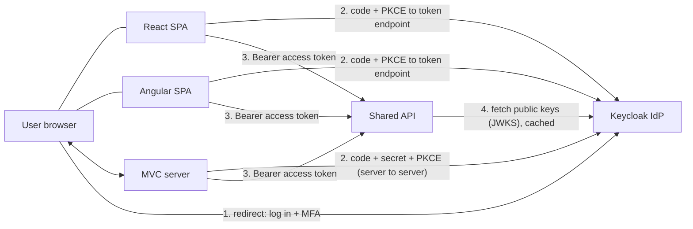
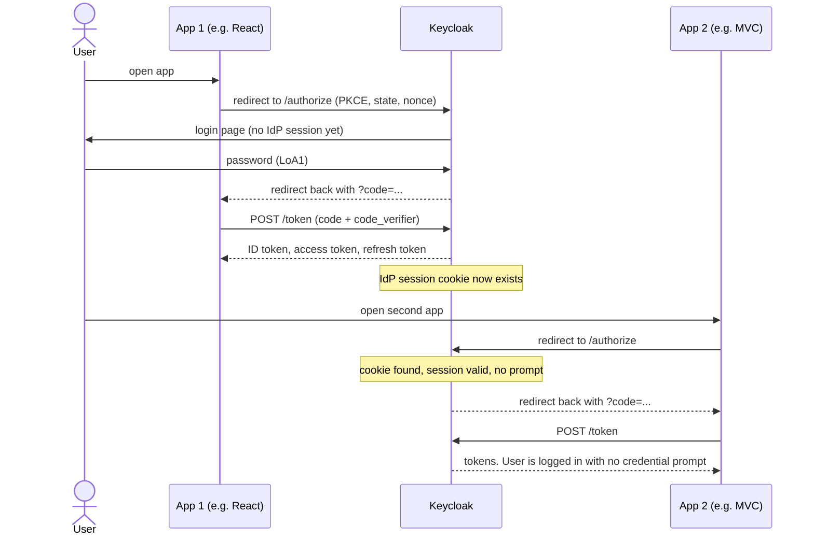

# Architecture: how the apps talk to the IdP

> Status: implemented for Keycloak (see [demo-domain.md](demo-domain.md), [api.md](api.md), [idp-keycloak.md](idp-keycloak.md)); remaining differences are reconciled in P6-1. Local IdP is Keycloak; see [BRIEF](../agent/BRIEF.md) for decisions.

## Demo domain: Acme Bank

The three apps are parts of one fictional bank, "Acme Bank" (fake data, no real brands), so the demo tells one story:

| App | Acme Bank role |
|-----|----------------|
| React | Customer Portal (accounts, balances, profile) |
| Angular | Payments and Transfers (send money, add payee) |
| MVC | Back Office / Admin (limits, approvals, user management) |

All use one shared API. Step-up window: 60 s (`STEPUP_MAX_AGE_SECONDS`), clock-skew leeway 5 s. See [step-up-actions.md](step-up-actions.md).

## Parts

| Part | Type | Talks to IdP as |
|------|------|-----------------|
| **React app** | SPA, runs in the browser | public client, Authorization Code + PKCE |
| **Angular app** | SPA, runs in the browser | public client, Authorization Code + PKCE |
| **MVC app** | ASP.NET Core MVC, runs on a server | confidential client (has a client secret), Authorization Code + PKCE |
| **API** | ASP.NET Core Web API, holds the sensitive actions | resource server: never logs anyone in, only validates tokens |
| **Keycloak** | the IdP, does login and MFA | |

**Key point:** users only ever type a password or TOTP code on Keycloak's page. The apps never see them. The apps only receive *tokens*.

## IdP endpoints used

All are discovered from `<issuer>/.well-known/openid-configuration`, so a different IdP only needs a different issuer URL (plus the differences listed in the adapter layer, Phase 5).

| Endpoint | Called by | How | Purpose |
|----------|-----------|-----|---------|
| `authorization_endpoint` | browser | redirect | Start login or step-up. Carries `code_challenge`, `state`, `nonce`, optionally `acr_values`, `max_age`, `prompt` |
| `token_endpoint` | app (SPA from browser, MVC from server) | HTTPS POST, back channel | Swap the one-time code for tokens; also **refresh** tokens |
| `jwks_uri` | API (and MVC for ID tokens) | HTTPS GET, cached | Public keys to check token signatures; re-fetched when an unknown `kid` appears (key rotation) |
| `end_session_endpoint` | browser | redirect | RP-initiated logout |

## SSO: why the second app does not ask for a login

Keycloak keeps its own **IdP session** (a cookie on the Keycloak domain). Each app has its own session with its own tokens. The IdP cookie is what links them.

What each app checks before trusting a login (code flow checklist):
1. `state` returned equals the one it sent (stops cross-site request forgery on the callback).
2. PKCE `code_verifier` proves the app that asked is the app redeeming the code.
3. ID token: signature (JWKS), `iss`, `aud` equals this app's client id, `exp`, `nonce` equals the one it sent.

## What the API checks on every request

Signature, `iss`, `aud` (must name the API), `exp`, then the *policy* for that action ([step-up-actions.md](step-up-actions.md)). The API trusts nothing the client says about itself.

## Logout

- Each app clears its own session/tokens, then redirects to `end_session_endpoint`, which ends the Keycloak session.
- Other apps are **not** told (back/front-channel logout is out of scope). Their local sessions and tokens keep working until the access token expires and refresh fails (see [token-lifecycle.md](token-lifecycle.md)), which is at most the IdP's refresh/session lifetime.

## Swapping the IdP

Keycloak is only the local default. IdP-specific behavior sits behind profiles and an adapter, so Entra ID, Okta, Cognito or another OIDC provider can be connected without changing app logic. See [idp-adapter.md](idp-adapter.md).

## Where config comes from

Everything IdP-specific (issuer, client ids, scopes, `acr` names) comes from environment variables (see `.env.example`). No real URLs, tenants or secrets in the repo.

## Logout (implemented)
Each app has local sign-out plus RP-initiated logout at the IdP (`end_session_endpoint` with `id_token_hint`). Ending the IdP session means the other apps ask for a login the next time they load or call the API. Back-channel and front-channel logout are out of scope by owner decision; an open tab in another app keeps its in-memory token until it expires (5 min) or reloads. Verified by running: sign-out in React, then Angular shows the IdP login page.
