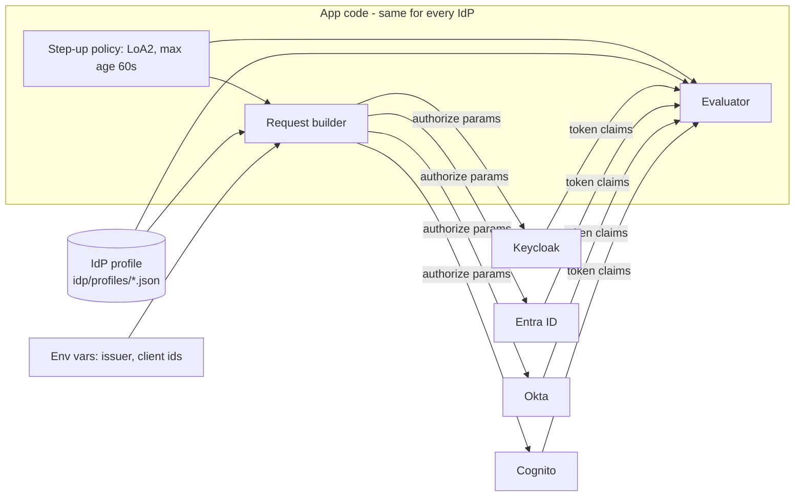

# IdP adapter: connecting any identity provider

> Status: implemented for Keycloak (tested). Profiles for Entra ID, Okta and Cognito are **templates from provider documentation, never run against a real tenant**. C# side: `packages/dotnet/IdpProfile`; TypeScript side: `packages/idp-profile` (builds requests only; enforcement is server-side, see [ADR-0004](decisions/0004-minimal-ts-profile-loader.md)). Profile files: `idp/profiles/`, schema `profile.schema.json`.

> Implementation note: the TypeScript side (`packages/idp-profile`) only **builds requests** and parses challenges; **enforcement is server-side** in the API (see [ADR-0004](decisions/0004-minimal-ts-profile-loader.md)).

## Goal

App code (React, Angular, MVC, API) never mentions a specific IdP. Connecting a new one means adding **a profile file and environment variables**, not changing app logic.

## What is the same everywhere, and what is not

Login itself is standard OIDC (discovery, Authorization Code + PKCE, JWKS), so it works with any compliant IdP using only an issuer URL and a client id. The **step-up part is where IdPs differ**:

| Question the app must answer | Differs by IdP |
|------------------------------|----------------|
| How do I *ask* for stronger authentication? | `acr_values` param, or Entra's `claims` param (authentication context), or not supported at all |
| How do I ask for a *fresh* login? | `max_age`, `prompt=login`, or neither |
| How does the token say *what level* the user reached? | `acr` (string), `acrs` (list), `amr` (list containing e.g. `mfa`) |
| How does the token say *when* the user authenticated? | `auth_time` claim, or it is missing |
| How does the API tell the client to step up? | RFC 9470 challenge with `acr_values`/`max_age`, or Entra's claims challenge |

These five answers are exactly what a profile captures.

## Internal model

The apps think in two internal terms only:

- **Level**: `LoA1` (password) or `LoA2` (password + MFA). Policies in [step-up-actions.md](step-up-actions.md) use these names.
- **Auth time**: when the user last really authenticated.

The profile translates between those and the provider's claims and parameters.



## Profile format (proposed)

One JSON file per IdP in `idp/profiles/`, chosen by `IDP_PROFILE=keycloak|entra|okta|cognito|generic`. No secrets in profiles.

```jsonc
{
  "name": "keycloak",
  "capabilities": {
    "acrValues": true, "maxAge": true, "promptLogin": true,
    "claimsParam": false, "emitsAuthTime": true, "emitsAmr": false
  },
  "level": {                       // how to read the level from a token
    "claim": "acr",
    "type": "string",              // "string" or "array"
    "map": { "LoA1": ["1"], "LoA2": ["2"] }
  },
  "authTime": { "claim": "auth_time" },
  "stepUpRequest": {               // how to ask for LoA2
    "acrValues": { "LoA2": "2" },
    "maxAge": true,
    "promptLogin": "when-stale"
  }
}
```

Entra ID would instead set `"claimsParam": true`, read `acrs` as an array, and put `{"id_token":{"acrs":{"essential":true,"value":"c1"}}}` in its request template, plus a `challenge` section describing Entra's claims-challenge format. Okta would map `LoA2` to `urn:okta:loa:2fa:any`. These are the shapes; the exact values are verified in Phase 5.

## Components

| Component | Job | Used by |
|-----------|-----|---------|
| Profile loader | Reads and validates the profile + env vars at startup. Fails fast with a clear message | all |
| Request builder | Policy + profile -> authorization request parameters | React, Angular, MVC |
| Evaluator | Validated token claims + profile + policy -> allowed / which level is missing / too old | API (authoritative), clients (only to avoid pointless calls) |
| Challenge writer / reader | API writes the 401 challenge; clients parse it (RFC 9470 standard, Entra variant) | API, clients |

The evaluator in the **API** is the only one that decides. Client copies are for convenience.

Implementation note: one profile format, thin code in two languages (TypeScript for the SPAs, C# for the API and MVC). Keep both implementations small and driven by the same profile file so they cannot drift.

## Provider notes (from provider documentation, 2026-10-23; only Keycloak was ever run)

| Provider | How step-up is requested | Token claims | API challenge | Profile | Source |
|----------|--------------------------|--------------|---------------|---------|--------|
| **Keycloak** | `acr_values=2`, `max_age` | `acr`, `auth_time` (in ID and access token via mappers) | RFC 9470 | `keycloak.json`, **tested** | [idp-keycloak.md](idp-keycloak.md) |
| **Entra ID** | Conditional Access **authentication context** (C1..C99) sent in the `claims` parameter; no `acr_values` | `acrs` (array, optional claim the resource must opt in to) | Entra claims challenge: `error="insufficient_claims"`, base64 `claims`, `cc_type="authcontext"` | `entra.json`, template, **untested** | [auth context guide](https://learn.microsoft.com/en-us/entra/identity-platform/developer-guide-conditional-access-authentication-context) |
| **Okta** | `acr_values=urn:okta:loa:2fa:any`, `max_age` (0 forces re-auth); unsupported values are ignored | `acr`, `auth_time` | callback error `unmet_authentication_requirements` when the level cannot be met | `okta.json`, template, **untested** | [step-up guide](https://developer.okta.com/docs/guides/step-up-authentication/main/) |
| **Amazon Cognito** ("AWS IdP" assumed to mean a Cognito user pool) | `acr_values=urn:cognito:loa:4` (password + TOTP) and `max_age`, **managed login only**, Essentials/Plus plan; a lower plan silently ignores `acr_values`; documented as rolling out gradually | `acr`, `amr`, `auth_time` in ID and access tokens; refresh keeps them | RFC 9470 (our API) | `cognito.json`, template, **untested** | [step-up](https://docs.aws.amazon.com/cognito/latest/developerguide/cognito-user-pools-step-up-authentication.html), [authorize endpoint](https://docs.aws.amazon.com/cognito/latest/developerguide/authorization-endpoint.html) |
| **Generic OIDC** | `acr_values` + `max_age` (assumed) | `acr`, `auth_time` | RFC 9470 | `generic.json`, same values as Keycloak, **untested elsewhere** | RFC 9470 |

Correction to an earlier assumption: this document first guessed Cognito would not honor `acr_values`. The current AWS documentation says it does (managed login, Essentials/Plus). It is still untested here.

Honest limits of the templates:
- **Entra** does not document `max_age` or a guaranteed `auth_time` for this flow, so its profile has `emitsAuthTime: false`. The API **refuses to start** with a max-age policy under that profile (run and verified). To use Entra you would either configure sign-in frequency in the Conditional Access policy and drop the API-side age check (a weaker, documented trade-off), or add an `auth_time` optional claim after verifying it in a real tenant.
- **Okta** ignores unsupported `acr_values`, and **Cognito** ignores them on a lower plan, so the client and the API both re-check the returned level (already implemented).
- The exact `acr` strings in real tokens must be confirmed against a real tenant.

## The freshness problem (honest limitation)

The API needs to know *when* the user did MFA. If an IdP does not emit `auth_time`:

- `iat` of a token is **not** a substitute: a refresh token produces a new `iat` without any new MFA.
- Options, from strongest: (1) configure the IdP to emit an auth-time claim; (2) use a provider-specific equivalent; (3) as a last resort, the app records "step-up completed at T" in a server session bound to the token, which is weaker and must be documented as such.

A profile with `emitsAuthTime: false` and no workaround is rejected at startup for any action with a max age, rather than silently skipping the check.

## Capability probe

A small script, `tools/idp-check`, reads `<issuer>/.well-known/openid-configuration` and prints what the IdP advertises (`acr_values_supported`, `claims_supported`, `code_challenge_methods_supported`, `end_session_endpoint`, grant types) next to what the chosen profile expects, and flags mismatches. Discovery metadata is not proof (some IdPs under-report), so the final check is the manual one in `docs/manual-checks.md` against a real tenant.

## Adding a new IdP (walkthrough)

Validated on 2026-10-23 by running the `generic` profile against the Keycloak realm: `idp-check` printed no mismatch, the API started with `IDP_PROFILE=generic`, `/me` returned the right level and a LoA1 token was challenged on `change-email`.

1. **Probe it.** `node tools/idp-check/index.mjs --issuer <issuer-url> --profile generic`. Read the warnings: discovery is not proof.
2. **Copy the template.** `copy idp/profiles/generic.json idp/profiles/<name>.json` and fill in the five answers (how to ask for a stronger login, how to ask for a fresh one, which claim carries the level, which carries the auth time, which challenge format). Set `"tested": false` and add `sources` URLs.
3. **Register the clients in the IdP**: redirect URIs from `.env.example`, PKCE S256, an audience for the API, and make sure the level and auth time are in the **access token**.
4. **Configure.** Set `IDP_PROFILE=<name>` and `IDP_ISSUER=<url>` (and client secrets) in `.env`. No app code changes. For Angular the value is read by `npm run dev:angular`.
5. **Start the API.** If the profile cannot provide an auth time and a policy has a max age, it refuses to start with a clear message (this is deliberate).
6. **Walk through** [manual-checks.md](manual-checks.md): login, SSO, step-up, expiry, cancel.
7. **Only then** add the IdP to the "tested IdPs" list in the README, with the date and what was run.

