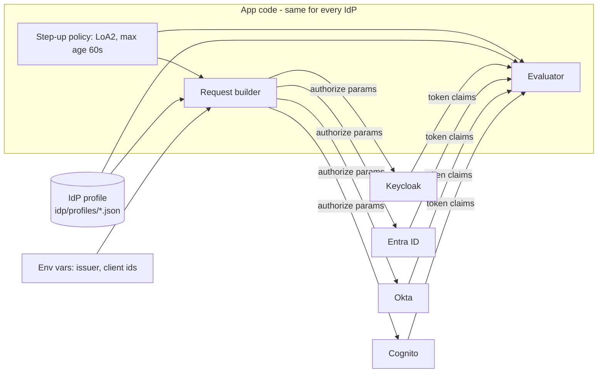

# IdP adapter: connecting any identity provider

> Status: design (not yet implemented). Only **Keycloak** will be tested. The Cognito, Entra ID and Okta profiles are templates built from provider documentation and must be verified against a real tenant before anyone relies on them.

## Goal

App code (React, Angular, MVC, API) never mentions a specific IdP. Connecting a new one means adding **a profile file and environment variables**, not changing app logic.

## What is the same everywhere, and what is not

Login itself is standard OIDC (discovery, Authorization Code + PKCE, JWKS), so it works with any compliant IdP using only an issuer URL and a client id. The **step-up part is where IdPs differ**:

| Question the app must answer | Differs by IdP |
|------------------------------|----------------|
| How do I *ask* for stronger authentication? | `acr_values` param, or Entra's `claims` param (authentication context), or not supported at all |
| How do I ask for a *fresh* login? | `max_age`, `prompt=login`, or neither |
| How does the token say *what level* the user reached? | `acr` (string), `acrs` (list), `amr` (list containing e.g. `mfa`) |
| How does the token say *when* the user authenticated? | `auth_time` claim, or it is missing |
| How does the API tell the client to step up? | RFC 9470 challenge with `acr_values`/`max_age`, or Entra's claims challenge |

These five answers are exactly what a profile captures.

## Internal model

The apps think in two internal terms only:

- **Level**: `LoA1` (password) or `LoA2` (password + MFA). Policies in [step-up-actions.md](step-up-actions.md) use these names.
- **Auth time**: when the user last really authenticated.

The profile translates between those and the provider's claims and parameters.



## Profile format (proposed)

One JSON file per IdP in `idp/profiles/`, chosen by `IDP_PROFILE=keycloak|entra|okta|cognito|generic`. No secrets in profiles.

```jsonc
{
  "name": "keycloak",
  "capabilities": {
    "acrValues": true, "maxAge": true, "promptLogin": true,
    "claimsParam": false, "emitsAuthTime": true, "emitsAmr": false
  },
  "level": {                       // how to read the level from a token
    "claim": "acr",
    "type": "string",              // "string" or "array"
    "map": { "LoA1": ["1"], "LoA2": ["2"] }
  },
  "authTime": { "claim": "auth_time" },
  "stepUpRequest": {               // how to ask for LoA2
    "acrValues": { "LoA2": "2" },
    "maxAge": true,
    "promptLogin": "when-stale"
  }
}
```

Entra ID would instead set `"claimsParam": true`, read `acrs` as an array, and put `{"id_token":{"acrs":{"essential":true,"value":"c1"}}}` in its request template, plus a `challenge` section describing Entra's claims-challenge format. Okta would map `LoA2` to `urn:okta:loa:2fa:any`. These are the shapes; the exact values are verified in Phase 5.

## Components

| Component | Job | Used by |
|-----------|-----|---------|
| Profile loader | Reads and validates the profile + env vars at startup. Fails fast with a clear message | all |
| Request builder | Policy + profile -> authorization request parameters | React, Angular, MVC |
| Evaluator | Validated token claims + profile + policy -> allowed / which level is missing / too old | API (authoritative), clients (only to avoid pointless calls) |
| Challenge writer / reader | API writes the 401 challenge; clients parse it (RFC 9470 standard, Entra variant) | API, clients |

The evaluator in the **API** is the only one that decides. Client copies are for convenience.

Implementation note: one profile format, thin code in two languages (TypeScript for the SPAs, C# for the API and MVC). Keep both implementations small and driven by the same profile file so they cannot drift.

## Provider notes (to verify, not assumed)

| Provider | What "AWS IdP" etc. likely means | Expected differences |
|----------|-----------------------------------|----------------------|
| **Keycloak** | tested reference | `acr`, `auth_time`; no native `amr` |
| **Entra ID** | Microsoft identity platform v2 | Step-up through Conditional Access *authentication context* and `claims` challenges, `acrs` claim, `amr` contains `mfa`. `auth_time` may be absent from tokens; may need an optional claim or a different freshness strategy |
| **Okta** | Okta Workforce/Customer Identity | `acr_values` such as `urn:okta:loa:2fa:any`, `max_age` and `prompt=login` supported; `auth_time` in ID token |
| **Amazon Cognito** | "AWS IdP" most likely means a Cognito user pool. IAM Identity Center is mainly for AWS access, not for signing users in to custom apps | MFA is configured per user pool, not requested per request. `acr_values` is likely not honored, so per-action step-up may need a different approach (for example a separate app client or user pool that always requires MFA) |
| **Generic OIDC** | any other compliant IdP | Works for login. Step-up works only if the profile can express its behavior |

**Please confirm which AWS service you mean** (Cognito vs IAM Identity Center). I assume Cognito.

## The freshness problem (honest limitation)

The API needs to know *when* the user did MFA. If an IdP does not emit `auth_time`:

- `iat` of a token is **not** a substitute: a refresh token produces a new `iat` without any new MFA.
- Options, from strongest: (1) configure the IdP to emit an auth-time claim; (2) use a provider-specific equivalent; (3) as a last resort, the app records "step-up completed at T" in a server session bound to the token, which is weaker and must be documented as such.

A profile with `emitsAuthTime: false` and no workaround is rejected at startup for any action with a max age, rather than silently skipping the check.

## Capability probe

A small script, `tools/idp-check`, reads `<issuer>/.well-known/openid-configuration` and prints what the IdP advertises (`acr_values_supported`, `claims_supported`, `code_challenge_methods_supported`, `end_session_endpoint`, grant types) next to what the chosen profile expects, and flags mismatches. Discovery metadata is not proof (some IdPs under-report), so the final check is the manual one in `docs/manual-checks.md` against a real tenant.

## Adding a new IdP

1. Run `tools/idp-check` against its issuer URL.
2. Copy `idp/profiles/generic.json` to `idp/profiles/<name>.json`; fill in the five answers from the table above.
3. In the IdP, register the clients (redirect URIs, PKCE, the API audience) and make sure the MFA level and auth time are present in the **access token**.
4. Set `IDP_PROFILE`, `IDP_ISSUER` and client ids in `.env`.
5. Walk through `docs/manual-checks.md` (login, SSO, step-up, stale window, cancel MFA).
6. Add the provider to the "tested IdPs" table in the README only if step 5 passed.
